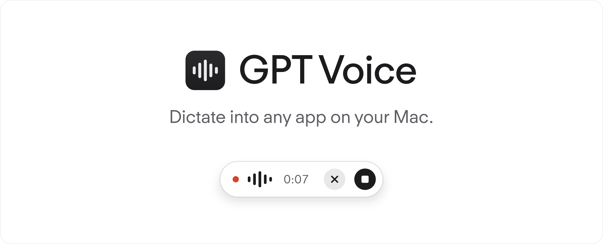

<p align="center">
  <picture>
    <source media="(prefers-color-scheme: dark)" srcset="docs/assets/readme-hero-dark.png">
    
  </picture>
</p>

<p align="center">
  <a href="https://entropyconquers.github.io/gpt-voice/">Website</a> ·
  <a href="https://github.com/entropyconquers/gpt-voice/releases">Mac releases</a> ·
  <a href="#see-it-in-action">Watch the demo</a> ·
  <a href="LICENSE">MIT license</a>
</p>

# GPT Voice

ChatGPT transcription in a small Mac menu bar app. Press a shortcut, speak, and put the transcript into your text field.
Use it with T3 Code, Codex CLI, your editor, or another app. It never submits the text for you.

I built this after moving from the Codex app to T3 Code and missing ChatGPT's dictation workflow.
GPT Voice uses your existing ChatGPT sign-in through Codex CLI. It needs no separate API key.

> Independent project. Not affiliated with OpenAI or T3 Code. Transcription uses a private ChatGPT endpoint that can change. Access and limits can vary by account.

## See it in action

https://github.com/user-attachments/assets/36b7513d-20c9-493e-bf01-f5ebfedf5899

[Watch or download the MP4](docs/media/GPT-Voice-Promo.mp4).
This is a staged promo with synthetic speech by [ElevenLabs](https://elevenlabs.io/), not a transcription benchmark.
Keyboard footage: [Designed by Magnific](https://www.magnific.com/). [All media credits](THIRD_PARTY_NOTICES.md).

## Install

**Requirements:** macOS 13 or later, internet access, [Codex CLI](https://developers.openai.com/codex/cli/), and a ChatGPT account with access to the transcription service.

1. Download the DMG from [Releases](https://github.com/entropyconquers/gpt-voice/releases).
2. Open it. Drag **GPT Voice** to **Applications**.
3. Open GPT Voice from Applications.
4. Reuse your existing session, or select **Sign in with ChatGPT**.
5. Grant microphone access. Grant Accessibility access for automatic paste, or choose manual paste.
6. Choose a shortcut and try the practice recording.

**Mac download:** [v0.1.4 — Apple Silicon and Intel](https://github.com/entropyconquers/gpt-voice/releases/download/v0.1.4/GPT-Voice-0.1.4-universal.dmg). This build uses a stable Apple Development signature. It is **not notarized by Apple**, so macOS may block it on first open.

If macOS says Apple cannot check or verify the app, or the developer is unidentified, use **System Settings → Privacy & Security → Open Anyway** after you decide to trust the download. If macOS says the app **will damage your computer**, do not override that warning. [Report its exact text](https://github.com/entropyconquers/gpt-voice/issues).

You can review the code and [build from source](#build-from-source) instead. Open source code does not replace Apple's malware checks. Microphone and Accessibility grants are separate from this verification warning.

## A small tool that stays out of the way

- A configurable global shortcut. The default is **Control–Option–Space**.
- A compact recording pill with input level, elapsed time, cancel and stop.
- Automatic paste, or **Command–V** for manual paste.
- Onboarding with permission recovery and an in-app practice step.
- System, Light and Dark themes, seven accent colors and top or bottom pill placement.
- Optional sound cues and launch at login. Launch at login starts off.
- Short result notices that fade away. Local transcript history with copy and delete controls.

History saves successful transcriptions on this Mac with their date, time, and known destination app. Copy any entry, delete one, or clear all.
Audio goes to ChatGPT for transcription. This is not an offline tool. [Read the privacy notes](docs/PRIVACY.md).

## Build from source

Install Xcode Command Line Tools and Python 3, then run:

```sh
git clone https://github.com/entropyconquers/gpt-voice.git
cd gpt-voice
swift test
./scripts/build.sh --install
```

The app appears in `~/Applications/GPT Voice.app`.
To build both Apple Silicon and Intel support, run `./scripts/build.sh --universal`.
Local builds use ad hoc signing by default. Keep a stable certificate across updates if you need persistent permission grants.
[Build and release details](docs/RELEASING.md).

## Questions

**Do I need an API key?** No. GPT Voice reuses the file-backed ChatGPT session from Codex CLI.

**Does it work with every ChatGPT subscription?** This is not verified. The private endpoint can restrict access or change behavior.

**Does ChatGPT need to be running?** No. Codex CLI supplies the shared session.

**Does it work offline?** No. Audio is sent to ChatGPT.

**Can I use Command–Space?** Yes, if Spotlight and other apps release that shortcut. The app checks conflicts before saving it.

**Why does Accessibility still show as missing?** A changed local signature can invalidate an old grant. See [troubleshooting](docs/TROUBLESHOOTING.md).

## Project

[How it works](docs/ARCHITECTURE.md) · [Contributing](CONTRIBUTING.md) · [Security](SECURITY.md) · [Privacy](docs/PRIVACY.md)

The app code is [MIT licensed](LICENSE). Third-party assets keep their original terms.
ChatGPT and OpenAI are trademarks of OpenAI. T3 Code belongs to its respective owners.
